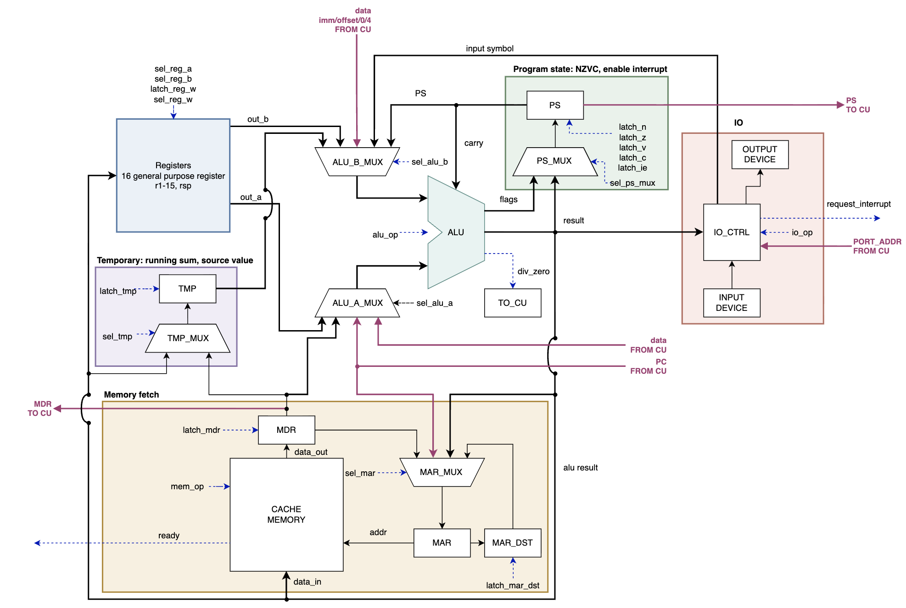
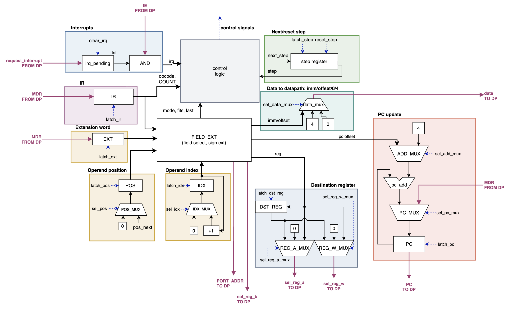
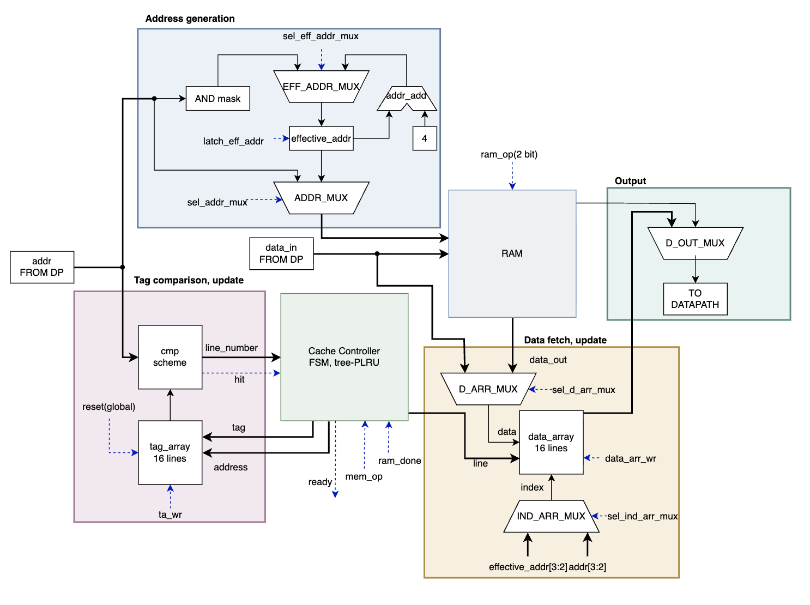

# Lab 4: assembler, linker and processor model

- **Student:** Добкес Михаил Константинович, group P3206, ISU number: 398893
- **Variant:**

  ```text
  asm | cisc | neum | hw | trap | port | pstr | cache | alg1
  ```

- **Implementation language:** Go.

This README is the short report which follows rules from lab4.md. 
The full description of the project (every instruction, signal, format and corner case)
is in **[docs/specification.md](docs/specification.md)**.

| Option  | How it is implemented                                                                                    |
|---------|----------------------------------------------------------------------------------------------------------|
| `asm`   | assembler with labels, sections, `.org`, macros, `#define`, `#ifdef`; separate translation + linker      |
| `cisc`  | 8 addressing modes, memory-to-memory operations, instructions of 1–8 words, `addm` with up to 7 operands |
| `neum`  | one memory for code and data                                                                             |
| `hw`    | hardwired control unit with a step register                                                              |
| `trap`  | input comes through interrupts on a tick schedule; the handler is written in asm                         |
| `port`  | separate `in` / `out` instructions with port numbers                                                     |
| `pstr`  | a string is a length word, then one word per character                                                   |
| `cache` | 16-line fully associative cache, tree-PLRU, write-through                                                |
| `alg1`  | `is_prime`, `format_string`                                                                              |

## Contents

- [Programming language](#programming-language)
  - [Syntax](#syntax)
  - [Semantics](#semantics)
- [Memory organization](#memory-organization)
- [Instruction set](#instruction-set)
  - [Processor features](#processor-features)
  - [Instructions](#instructions)
  - [Interrupts](#interrupts)
  - [Encoding](#encoding)
  - [Ticks per instruction](#ticks-per-instruction)
  - [CISC traits](#cisc-traits)
- [Translator](#translator)
  - [CLI](#cli)
  - [Pipeline](#pipeline)
  - [Object file](#object-file)
- [Processor model](#processor-model)
  - [Simulator](#simulator)
  - [DataPath](#datapath)
  - [ControlUnit](#controlunit)
  - [Cache](#cache)
  - [How the simulation works](#how-the-simulation-works)
  - [Journal](#journal)
- [Testing](#testing)
  - [Toolchain usage example](#toolchain-usage-example)
  - [Cache impact](#cache-impact)
- [CI](#ci)

## Programming language

### Syntax

Described in EBNF:

```text
(* --- structure --- *)
<program>   ::= { <line> | <macro> | <define> | <condition> | <directive> }
<end>       ::= [ <comment> ] <eol>
<eol>       ::= "\n" | <EOF>

(* --- preprocessor --- *)
<macro>     ::= "#macro" <name> "," <non_neg_number> { "\n" }
                "{" <end>
                { <raw_line> }
                "}" <end>
<raw_line>  ::= ? any characters except newline, or unopened "}" ? <eol>

<define>    ::= "#define" <name> [ <value> ] <eol>

<condition> ::= ( "#ifdef" | "#ifndef" ) <name> <end>
                <program>
                [ "#else" <end> <program> ]
                "#endif" <end>

(* --- directives --- *)
<directive> ::= ( ".section" ( "data" | "text" )
                | ".org" <non_neg_number>
                | ".import" <name>
                | ".export" <name>
                ) <end>

(* --- lines --- *)
<line>        ::= [ <label> ] [ <data> | <instruction> ] <end>
<label>       ::= <name> ":"

<data>        ::= ".word" <word> { "," <word> }
                | ".pstr" <string>
                | ".ref" <name>
<word>        ::= <number> | <char>

<instruction> ::= <command> [ <operand> { "," <operand> } ]
<command>     ::= ? any mnemonic from the instruction list, or a macro name ?

<operand>     ::= <register>                                        (* register *)
                | "(" ( <non_neg_number> | <name> ) ")"             (* direct *)
                | "(" "@" <name> ")"                                (* PC-relative *)
                | "(" <register> ")"                                (* indirect *)
                | "(" <register> ")" "+"                            (* postincrement *)
                | "-" "(" <register> ")"                            (* predecrement *)
                | "(" <register> ( "+" | "-" ) <non_neg_number> ")" (* register-relative *)
                | <number> | <name> | <char>                        (* immediate *)
                | "@" <name>                                        (* jump PC-relative *)
<register>    ::= "rsp" | "r1" | "r2" | ... | "r15"

(* --- tokens --- *)
<name>           ::= ( <letter> | "_" ) { <letter> | <digit> | "_" }
<number>         ::= [ "-" ] <non_neg_number>
<non_neg_number> ::= <digit> { <digit> } | "0x" <hex_digit> { <hex_digit> }
<char>           ::= '"' <str_char> '"'
<string>         ::= '"' { <str_char> } '"'
<str_char>       ::= ? printable ASCII character 0x20–0x7E, except "\" and '"' ?
                   | "\" ( "n" | "t" | "\" | '"' | "0" )
<comment>        ::= ";" { ? any UTF-8 character except newline ? }
<value>          ::= ? any characters up to the end of the line ?

<letter>, <digit>, <hex_digit> have their usual meaning: a–z A–Z; 0–9; 0–9 a–f A–F.
<EOF> is the end of input.
```

Example:

```asm
.export _start
.export _handler
.import print
.import inputPush

#define STACK_TOP 0x1000

_start:
    mov rsp, STACK_TOP
    mov r1, msg
    call print          ; stdlib: print a pstr
    halt

_handler:               ; every input character raises an interrupt
    call inputPush      ; stdlib: put the character into the input buffer
    iret

.section data
msg: .pstr "Hello, world!\n"
```

### Semantics

- **Evaluation.** Instructions run one by one, starting from `_start`. Every operand
  is computed by its addressing mode when the instruction runs.
- **Compile time.** `#define`, macros and `#ifdef` are text substitution, done by the preprocessor in one pass.
  A label used before its definition is recorded as a fixup. At the end of the file the assembler resolves
  PC-relative fixups in the same file and section; everything else (absolute addresses,
  imported labels, labels in the other section) becomes a relocation for the linker.
- **Scope.** Defines and macros are local for the file. Labels are local by default but can be used in other files by
  `.export label` and `.import label`
- **Types.** There are no types: every value is a 32-bit machine word. The instruction chooses signed or unsigned
  meaning (`jl` vs `jb`, `mulh` vs `umulh`).
- **Literals.** Positive and negative decimals `42`, `-7`, hex `0x2A`, characters `"a"` (ASCII code). Strings are allowed only in
  `.pstr`. Escapes: `\n \t \\ \" \0`.
- **Sections.** `text`  holds only instructions, `data` holds only data. `.org N` sets the offset inside
  the current file's part of the section.
- **Entry points.** `_start` is required, `_handler` is optional. Both must be exported.
  `rsp` is not initialized at reset, so `_start` must set it before the first `call`, `push` or `ei`.
- **Standard library** (linked by default): `print`, `printChar`, `readChar`, `readLine`, `strEq`, `strConcat`,
  `strContains`, `intToStr`, `strToInt` and `inputPush` for the interrupt handler.

## Memory organization

- Von Neumann: one single-port memory for code and data, byte addressing, 32-bit words, little-endian.
- Every access reads or writes 4 bytes. Unaligned access works, but it bypasses the cache and should not be used.
- Size is set in the simulator config (`memory_size`, 4096 bytes by default).
- Registers for the programmer: `rsp`, `r1`–`r15` (32 bits). PC and PS (IE + NZVC) are not addressable.
- IO ports are a separate address space: port 0 — input, port 1 — output.

Code and data share one memory. The linker builds the image in this order; the stack starts at the address
`_start` puts into `rsp` and grows down toward `data`:
```text
          Memory
+-------------------------------+
| 0x0  : reset vector → _start  |
| 0x4  : irq vector → _handler  |
| 0x8  : text, file 1           |
|        text, file 2           |
|        ...                    |
|        text, stdlib           |
|        data, file 1           |
|        ...                    |
|        data, stdlib           |
|        free                   |
|        ...                    |
| top  : stack (grows down)     |
+-------------------------------+
```

How each kind of program entity is handled when the program is built and when it runs:

| What        | Compile time                                                                                                                                             | Run time                                                                                    |
|-------------|----------------------------------------------------------------------------------------------------------------------------------------------------------|---------------------------------------------------------------------------------------------|
| Literal     | fits in $[-2^{15},\ 2^{15}-1]$ → immediate inside the instruction;<br/> bigger → translator error, the programmer needs to put it in `data` with `.word` | immediate comes with the instruction fetch; a value in `data` is read with a memory operand |
| Constant    | `#define`: the preprocessor replaces it with its text, no memory                                                                                         | —                                                                                           |
| Variable    | `.word` in `data`: static, the linker gives it the final address                                                                                         | read and written with any memory mode                                                       |
| String      | `.pstr` in `data`: length word, then one word per character                                                                                              | read word by word, e.g. with `(r1)+`                                                        |
| Instruction | encoded in `text`, 1–8 words; the linker gives final addresses                                                                                           | fetched word by word, PC += 4                                                               |
| Procedure   | a label in `text`; the `call` target is resolved by the assembler or the linker                                                                          | `call` pushes `ret_addr`, `ret` pops it                                                     |
| Interrupt   | `_handler` in `text`; the linker writes its address to the vector at `0x4`                                                                               | entry pushes PC and PS, `iret` pops them                                                    |

- Values in `data` are placed in source order, word after word; each file's part follows the previous file's.
  A multi-word value goes low word first (64-bit: `addr` — bits 31:0, `addr + 4` — bits 63:32).
- There is no register allocation: the programmer decides what to keep in registers. If there are not
  enough registers, values are kept on the stack or in `data`.
- The stack holds return addresses, saved registers, PC and PS of an interrupt, arguments after the 4th and
  local values (`push`, `(rsp+n)`). It is the only dynamic memory: there is no heap.
- Addressing is by byte; the 8 operand addressing modes are listed in [Processor features](#processor-features).

## Instruction set

### Processor features

- 16 registers: `rsp` (#0) and `r1`–`r15`. PS holds the flags NZVC and the interrupt enable bit IE.
- Word: 32 bits. There are no data types: every value is a word, signed (two's complement) or unsigned
  by instruction. A character is one byte, stored in its own word.
- IO is port-mapped: `in` / `out` with an immediate port number. Port 0 holds the last input character
  (its arrival raises the interrupt), port 1 appends a character to the output.
- Control flow: `jump` / `call` take a PC-relative or an absolute target; conditional branches are always
  PC-relative and check NZVC (`jl`, `jg`, … — signed, `jb`, `ja`, … — unsigned).
- Flags: N — result bit 31, Z — result is 0, V — signed overflow, C — unsigned carry
  (borrow for `sub`, `subc`, `cmp`, `neg`; the last bit shifted out for shifts).
- Most instructions take any addressing mode for both operands, including memory for both at once:

| # | Mode              | Syntax         | Field (bits) | Effective address / value  |
|---|-------------------|----------------|--------------|----------------------------|
| 0 | register          | `r1`           | 4            | the register itself        |
| 1 | direct            | `(0x120)`      | 32           | the absolute address       |
| 2 | PC-relative       | `(@label)`     | 16           | `operand_pc_next + offset` |
| 3 | indirect          | `(r1)`         | 4            | `r1`                       |
| 4 | postincrement     | `(r1)+`        | 4            | `r1`, then `r1 ← r1 + 4`   |
| 5 | predecrement      | `-(r1)`        | 4            | `r1 ← r1 − 4`, then `r1`   |
| 6 | immediate         | `120`, `label` | 16           | the value itself           |
| 7 | register-relative | `(r1+8)`       | 20           | `r1 + offset`              |

`operand_pc_next` is the address right after the word that holds the offset.

### Instructions

A short overview by group. The full command description and flags change is in
[Commands](docs/specification.md#commands) in the specification.

| Group        | Instructions                                                                                    | Format     |
|--------------|-------------------------------------------------------------------------------------------------|------------|
| Data         | `mov`; aliases `push x` = `mov -(rsp), x`, `pop x` = `mov x, (rsp)+`                            | F2         |
| Logic        | `clr`, `not`; `and`, `or`, `xor`, `test`                                                        | F1; F2     |
| Arithmetic   | `inc`, `dec`, `neg`; `add`, `addc`, `sub`, `subc`, `mull`, `mulh`, `umulh`, `div`, `mod`, `cmp` | F1; F2     |
| Multi-add    | `addm dst, src1, ..., src6` — `dst ← dst + src1 + ... + src6`                                   | FA         |
| Shifts       | `lsl` (`asl`), `lsr`, `asr`                                                                     | F2         |
| Stack        | `pushm`, `popm` (1–16 registers); `call`; `ret`, `iret`                                         | FP; FJ; F0 |
| IO           | `in dst, port`, `out port, src`                                                                 | F2         |
| Control flow | `jump`; `jz jnz ja jae jb jbe jl jle jg jge`; `ei`, `di`, `halt`                                | FJ; FB; F0 |

- Flags are set from the result; every instruction has its own set.
- `div` / `mod` by zero, a wrong port and an access outside memory stop the machine with a fault.

### Interrupts

- A character from the input schedule arrives: `IO[0] ← char`, `irq_pending ← 1`.
- At the last tick of each instruction, if `irq_pending` and IE are both 1: push PC, push PS, IE ← 0,
  PC ← mem[0x4]. `iret` pops PS, then PC.
- **Interrupt during interrupt:** the handler runs with IE = 0. A new request is kept in `irq_pending`
  (one bit, no queue) and is checked after `iret`; a character that comes before the previous one was read
  overwrites it. Programmer can run `ei` to allow nesting.

### Encoding

Opcode is 6 bits, the mode of an operand is 3 bits. Word 1 always holds the opcode and all modes, so the CU
knows the whole layout after the first fetch. Operand values are packed **next-fit** from bit 0: a value goes into
the rest of the current word if it fits, otherwise into the next word.

| Format | Instructions       | Word 1                                                                  | Size |
|--------|--------------------|-------------------------------------------------------------------------|------|
| F0     | `halt`, `ret`, ... | `[31:26 OPCODE][25:0 0]`                                                | 1    |
| F1     | `inc`, `clr`, ...  | `[31:26 OPCODE][25:23 MODE][22:0 operand]`                              | 1–2  |
| F2     | `mov`, `add`, ...  | `[31:26 OPCODE][25:23 MODE1][22:20 MODE2][19:0 operands]`               | 1–3  |
| FB     | `jz`, `jl`, ...    | `[31:26 OPCODE][25:16 0][15:0 offset]`                                  | 1    |
| FJ     | `jump`, `call`     | `[31:26 OPCODE][25 K][24:16 0][15:0 offset]`, K = 0 → address in word 2 | 1–2  |
| FP     | `pushm`, `popm`    | `[31:26 OPCODE][25:22 COUNT][19:0 5 registers]`, then 8 per word        | 1–3  |
| FA     | `addm`             | `[31:26 OPCODE][25:23 COUNT][20:0 7 modes]`, values from word 2         | 2–8  |

Signed fields are sign-extended; register-relative is `reg#` in [19:16] + offset in [15:0]. Opcodes of all
instructions are in [Opcodes](docs/specification.md#opcodes).

Example from the [cisc test](golden_test/testdata/cisc.yml), one instruction of 7 words:

```text
000000C8 - 4B1BFFF8 - addm r6 , ( r4 + 4 ) , ( r4 + 8 ) , ( r4 + 12 ) , ( r4 + 16 ) , ( r4 + 20 ) , 100
000000CC - 00400046
000000D0 - 00040008
000000D4 - 0004000C
000000D8 - 00040010
000000DC - 00040014
000000E0 - 00000064
```

### Ticks per instruction

An instruction takes $N$ ticks without memory, plus the cost of every memory access:

$$t = N + \sum_{\text{accesses}} T_{\text{access}}$$

| Access          | `cache: false` | `cache: true`  |
|-----------------|----------------|----------------|
| aligned read    | 10             | hit 1, miss 15 |
| unaligned read  | 10             | 11             |
| aligned write   | 10             | 11             |
| unaligned write | 10             | 12–13          |

$R$ / $W$ — reads / writes (word 1 and every extension word are reads) \
$e$ — extension words \
$a(m)$ — address steps of a mode: 0 for register and immediate, 2 for `(r)+`, 1 for the others. \
$k_{\text{mem}}$ — number of memory operands of `addm`.

| Instruction                  | $N$                                   | $R$                                                       | $W$                            |
|------------------------------|---------------------------------------|-----------------------------------------------------------|--------------------------------|
| F1, F2                       | $3 + d + a(m_{src}) + e + s$          | $1 + e + [\text{src in mem}] + [\text{dst in mem, read}]$ | $[\text{dst in mem, written}]$ |
| `halt`, `ei`, `di`           | 4                                     | 1                                                         | 0                              |
| `ret` / `iret`               | 5 / 7                                 | 2 / 3                                                     | 0                              |
| branch, `jump @l` / `jump l` | 4                                     | 1 / 2                                                     | 0                              |
| `call @l` / `call l`         | 4                                     | 1 / 2                                                     | 1                              |
| `pushm` / `popm`, $n$ regs   | $3 + n + e$ / $4 + 2n + 2e$           | $1 + e$ / $1 + n + e$                                     | $n$ / 0                        |
| `addm` $m_1 \dots m_k$       | $3 + e + \sum_i \big(a(m_i) + 1\big)$ | $1 + e + k_{\text{mem}}$                                  | $[m_1 \text{ in mem}]$         |
| interrupt entry              | 4                                     | 1                                                         | 2                              |

F1/F2 terms: $d = 1$ for a register destination (and the `out` port), $a(m_{dst})$ for a memory one;
$s = 1$ if the source is in memory, or sits in a later word than a memory destination, or the instruction is `out`.
The destination is read by all except `mov`, `clr`, `in`; written by all except `cmp`, `test`, `out`.

Examples (no cache, $t = N + 10\,(R + W)$):

| Instruction        | $e$ | $N$ | $R$ | $W$ | $t$ |
|--------------------|-----|-----|-----|-----|-----|
| `add r1, r2`       | 0   | 4   | 1   | 0   | 14  |
| `mov r3, (r2)+`    | 0   | 7   | 2   | 0   | 27  |
| `add (r1), 7`      | 0   | 4   | 2   | 1   | 34  |
| `mov (buf), r4`    | 2   | 7   | 3   | 1   | 47  |
| `add (buf), (r2)+` | 2   | 9   | 5   | 1   | 69  |

### CISC traits

- Memory to memory operations: `add (total), (@seed)`.
- 8 addressing modes, including postincrement, predecrement and register-relative.
- Variable length: 1–8 words. `addm` sums up to 7 operands of any mode, `pushm` / `popm` take a register list.
- The CU fetches every extension word as a separate step (`of_dst_ext`, `of_src_ext`), which is visible in the journal.

## Translator

### CLI
```text
ailurus-build [flags] FILE...
```

| Flag              | Meaning                                                  |
|-------------------|----------------------------------------------------------|
| `-o FILE`         | output binary (default `a.bin`)                          |
| `-l FILE`         | debug listing: `<address> - <HEXCODE> - <source>`        |
| `-c`              | assemble only: one `.o` (JSON object file) per input     |
| `-E`              | preprocess only                                          |
| `-D NAME[=value]` | define `NAME` in every file                              |
| `--no-stdlib`     | do not link the standard library                         |

`FILE` is an `.asm` or `.o` file.

### Pipeline

The work goes in three stages:
1. **Preprocessor** — one pass over the text: defines, macros, conditional blocks. Every line keeps its
   `file:line`, so errors and the listing point to the real source.
2. **Assembler** — one pass + fixups. The size of an instruction depends only on the mnemonic and the modes,
   so it can be encoded right away. Every label operand is encoded as 0 right away, a PC-relative reference to a label
   in the same file and section is fixed at the end of the file, all others go to the relocation table.
   The result is an object file.
3. **Linker** — places all `text` parts, then all `data` parts, resolves imports, applies relocations and writes
   the vectors `0x0` (`_start`) and `0x4` (`_handler`). The output is a flat binary image.

### Object file

The object file (`.o`, from `-c`) is JSON, because it is an intermediate file and should be easy to read.
The executable has binary format, as the task specified.
It holds the section bytes, the symbol table and the relocations:

```json
{
  "version": 1,
  "source": "main.asm",
  "sections": { "text": "<bytes, hex>", "data": "<bytes, hex>" },
  "symbols": [
    { "name": "print",  "binding": "import" },
    { "name": "_start", "binding": "export", "section": "text" },
    { "name": "msg",    "binding": "local",  "section": "data", "offset": 0 }
  ],
  "relocations": [
    { "section": "text", "offset": 0, "bit": 4, "width": 16, "kind": "pcrel16", "symbol": "msg", "pc_next": 4 },
    { "section": "text", "offset": 8, "bit": 0, "width": 32, "kind": "abs32",   "symbol": "print" }
  ]
}
```

A relocation says which field to fill (`offset`, `bit`, `width`) and how: `abs32` / `imm16` — the symbol
address, `pcrel16` — the address minus `pc_next`. The full format is in
[Object file format](docs/specification.md#object-file-format).

## Processor model

### Simulator

```text
ailurus-run [-c config.yml] [-l prog.lst] [-j journal.txt] prog.bin
```

| Flag      | Meaning                                                                              |
|-----------|--------------------------------------------------------------------------------------|
| `-c FILE` | config (YAML): memory size, cache on/off, tick limit, input schedule, journal window |
| `-l FILE` | listing from `ailurus-build -l`: adds source lines to the journal                    |
| `-j FILE` | journal output file                                                                  |

```yaml
memory_size: 4096
cache: true
tick_limit: 100000
input:              # input schedule: [tick, char]
  - [10, "h"]
  - [25, "i"]
journal:
  mode: tick        # instr: one line per instruction; tick: one line per tick + instruction lines
  from_tick: 0
  to_tick: 400
```

The output buffer goes to stdout. The summary and stats go to stderr:

```text
halted after 535 ticks
memory wait: 98 ticks
cache: 84 hits, 7 misses (92.3% hit rate), 0 evictions, 0 writes, 0 bypasses
```

### DataPath



On every step the CU picks the two ALU inputs: ALU_A_MUX chooses from a register, PC, MDR or a constant,
and ALU_B_MUX from a register, TMP, a constant, PS or the input port. The ALU output `result` is the main bus.
It can go to a register, MAR (an address), TMP, PS, the memory write data or the output port. A word read from
memory lands in MDR. MAR_DST keeps the destination address while the source is read, and TMP keeps a value
between steps. For example, `add (r1), r2` runs as `MAR ← r1`, `MDR ← mem[MAR]`, `TMP ← MDR + r2`,
`mem[MAR] ← TMP`.

| Element                                    | Inputs                            | Purpose                                                    |
|--------------------------------------------|-----------------------------------|------------------------------------------------------------|
| Registers (`sel_reg_a/b/w`, `latch_reg_w`) | `result`                          | 16 registers, read ports `out_a`, `out_b`                  |
| ALU_A_MUX (`sel_alu_a`)                    | `out_a`, PC, MDR, `data` from CU  | ALU input A                                                |
| ALU_B_MUX (`sel_alu_b`)                    | `out_b`, TMP, `data`, PS, IO data | ALU input B                                                |
| ALU (`alu_op`)                             | A, B, carry                       | 21 operations, gives `result`, NZVC, `div_zero`            |
| MAR_MUX (`sel_mar`) → MAR                  | `result`, PC, MDR, MAR_DST        | memory address                                             |
| MAR_DST (`latch_mar_dst`)                  | MAR                               | keeps the destination address while the source is fetched  |
| MDR (`latch_mdr`)                          | memory `data_out`                 | the last word read                                         |
| TMP_MUX (`sel_tmp`) → TMP                  | MDR, `result`                     | source value, or the running sum of `addm`                 |
| PS_MUX (`sel_ps_mux`) → PS                 | ALU flags, `result`               | flags; `result` for `iret`, `ei` / `di`; one latch per bit |
| Memory (`mem_op`)                          | address MAR, data `result`        | cache or RAM, answers with `data_out` and `ready`          |
| IO_CTRL (`io_op`, port)                    | `result`                          | ports 0 / 1, raises `request_interrupt`                    |

### ControlUnit



Fetch reads word 1 into IR (`MAR ← PC`, `MDR ← mem[MAR]`, `IR ← MDR`, `PC ← PC + 4`). From the opcode and
the modes in IR, FIELD_EXT knows where every operand is. IDX and POS point to the current operand. If the
operand is in the next word (`fits = 0`), the CU reads that word into EXT and moves IDX to it. `control logic`
is combinational: from the step, the opcode, the FIELD_EXT outputs, the flags and `ready`, it makes all control
signals and the next step. While memory is not `ready`, the step register holds. At the last tick of an
instruction, if `irq` is set, the CU goes to `irq0`–`irq6` (push PC, push PS, IE ← 0, PC ← mem[0x4])
instead of the next fetch.

| Element               | Signals                                        | Purpose                                                                                        |
|-----------------------|------------------------------------------------|------------------------------------------------------------------------------------------------|
| step register         | `latch_step`, `reset_step`                     | the CU state: `fetch0`, `of_dst0`, `of_src1`, `exec0`, `wb0`, `irq0`, ...                      |
| IR, EXT               | `latch_ir`, `latch_ext`                        | word 1 of the instruction and the current extension word                                       |
| IDX, POS              | `latch_idx`, `sel_idx`, `latch_pos`, `sel_pos` | word number and bit position of the current operand                                            |
| FIELD_EXT             | — (combinational)                              | finds the current operand from the layout in IR, sign-extends it; gives `mode`, `fits`, `last` |
| DST_REG               | `latch_dst_reg`                                | destination register number, kept while sources are fetched                                    |
| REG_A_MUX / REG_W_MUX | `sel_reg_a_mux`, `sel_reg_w_mux`               | register number: FIELD_EXT `reg`, DST_REG or 0 (`rsp`)                                         |
| data_mux              | `sel_data_mux`                                 | constant for the DataPath: imm/offset, 4, 0                                                    |
| PC, ADD_MUX, PC_MUX   | `latch_pc`, `sel_add_mux`, `sel_pc_mux`        | `PC ← PC + 4`, `PC + offset` or MDR (`ret`, `iret`, absolute jumps, vectors)                   |
| irq_pending, AND      | `clear_irq`                                    | `irq = irq_pending AND IE`                                                                     |

### Cache



The DataPath sends `mem_op` and `addr`. `cmp scheme` compares the tag of `addr` with all 16 tags at once and
gives `hit` and `line_number`. On a read hit, IND_ARR_MUX picks the word by `addr[3:2]`, and D_OUT_MUX sends it
to the DataPath in the same tick. On a miss, the controller picks a victim line (an invalid one first, then
tree-PLRU) and sets `effective_addr` to the line start. It then reads 4 words from RAM: 10 ticks for the first,
1 tick for each next one (`read_next`), each stored at `effective_addr[3:2]`. Finally it writes the tag and
returns the word. A write always goes to RAM and also updates `data_array` on a hit (write-through). An unaligned
read bypasses the cache through D_OUT_MUX. After an unaligned write, the controller checks `addr` and `addr + 4`
through CMP_MUX and clears the valid bit of every line the write touched.

- 16 lines × 16 bytes, fully associative, tree-PLRU (invalid lines are used first).
- Write-through, no allocation on a write miss. A read miss fills the whole line with a burst:
  the first word takes 10 ticks, the next three take 1 tick each (`ram_op = read_next`).
- The controller is an FSM: `IDLE`, `FILL`, `TAG`, `BYPASS_R`, `WRITE`, `INV1`, `INV2`.

| Access          | Ticks | What happens                                        |
|-----------------|-------|-----------------------------------------------------|
| read hit        | 1     | word from `data_array`                              |
| read miss       | 15    | IDLE + 10 + 3 × 1 burst + TAG                       |
| unaligned read  | 11    | bypass: one RAM read, cache untouched               |
| aligned write   | 11    | RAM write; on a hit `data_array` is updated too     |
| unaligned write | 12–13 | RAM write, then invalidate the 1 or 2 touched lines |

### How the simulation works

The model follows the scheme. Every block (DataPath, ControlUnit, cache, RAM, IO controller) has two methods:
`outputs` (combinational logic, no state change) and `clock` (the clock edge, the only place where state
changes). One tick of `Machine` does this:

1. take the latched values (registers, MAR, MDR, PS);
2. the CU computes the control signals from its step, IR and FIELD_EXT;
3. IO, ALU and memory compute their outputs;
4. clock edge: all blocks latch at once, and the tick goes to the journal.

The run stops on `halt`, on a fault or at `tick_limit`.

### Journal

An instruction line comes after the last tick of every instruction. `irq=N` is the interrupt depth, so it is
always clear if the processor is inside the handler:

```text
=== 00000024  call inputPush                 tick=163 irq=1
    rsp=00000FF0  r1=00000000  r2=00000000  r3=00000000  r4=00000000  r5=00000000  r6=00000000  r7=00000000
     r8=00000000  r9=00000000 r10=00000000 r11=00000000 r12=00000000 r13=00000000 r14=00000000 r15=00000000  NZVC=0100 IE=0
```

In `mode: tick` there is also one line per tick: the step, registers, the memory event (`hit line N`, `miss`,
`fill wait`, `wait`, ...), the IO event and the active control signals:

```text
    106 irq0       PC=00000088 IR=6000FFF8 MAR=00000FF8 MDR=6000FFF8 IDX=0 POS= 0 irq=1         mem:-              io:-               | latch_reg_w latch_mar clear_irq
```

## Testing

All integration tests are golden tests: [golden_test/golden_test.go](golden_test/golden_test.go) and one YAML
file per test in [golden_test/testdata](golden_test/testdata). Big journals are cut to an interesting
tick window with `from_tick` / `to_tick`.

Example ([hello.yml](golden_test/testdata/hello.yml), shortened):

```yaml
description: prints a pstr, no stdlib
sources:
  main.asm: |
    .export _start
    _start:
        mov r1, msg
        mov r2, (r1)+
    loop:
        cmp r2, 0
        jz done
        out 1, (r1)+
        dec r2
        jump @loop
    done:
        halt
    .section data
    msg: .pstr "Hello, world!\n"
build_args:
  - --no-stdlib
config: |-
  journal:
    mode: instr
summary: |-
  halted after 535 ticks
  memory wait: 98 ticks
  cache: 84 hits, 7 misses (92.3% hit rate), 0 evictions, 0 writes, 0 bypasses
output: |
  Hello, world!
listing: |
  00000000 - 00000008 - _start address
  00000004 - 00000000 - _handler address
  00000008 - A0600281 - mov r1 , msg
  0000000C - A0400012 - mov r2 , ( r1 ) +
  ...
journal: |
  === 00000008  mov r1 , msg                   tick=20 irq=0
      rsp=00000000  r1=00000028  r2=00000000  r3=00000000  r4=00000000  r5=00000000  r6=00000000  r7=00000000
       r8=00000000  r9=00000000 r10=00000000 r11=00000000 r12=00000000 r13=00000000 r14=00000000 r15=00000000  NZVC=0000 IE=0
  ...
```

How to run:

```shell
make test                         # all golden tests
go test ./golden_test -update     # rewrite the expected fields
```

| Test                                                                      | What it shows                                                               |
|---------------------------------------------------------------------------|-----------------------------------------------------------------------------|
| [hello](golden_test/testdata/hello.yml)                                   | print a `pstr` without the stdlib                                           |
| [hello_stdlib](golden_test/testdata/hello_stdlib.yml)                     | the same with the stdlib `print`                                            |
| [cat](golden_test/testdata/cat.yml)                                       | echo the input until the tick limit; a character arrives during the handler |
| [hello_user_name](golden_test/testdata/hello_user_name.yml)               | ask for a name, read it, greet                                              |
| [sort](golden_test/testdata/sort.yml)                                     | read numbers one per line, print them sorted                                |
| [double](golden_test/testdata/double.yml)                                 | 64-bit arithmetic: $n!$ and $1! + \dots + n!$ for $n = 20$                  |
| [is_prime](golden_test/testdata/is_prime.yml)                             | `alg1`: is_prime for a list of numbers                                      |
| [format_string](golden_test/testdata/format_string.yml)                   | `alg1`: `%d`, `%5d`, `%-5d`, `%05d`                                         |
| [format_string_too_long](golden_test/testdata/format_string_too_long.yml) | `alg1`: a too long format line gives `-1`                                   |
| [link](golden_test/testdata/link.yml)                                     | separate translation: 2 files, import/export, relocations, `-D`             |
| [cisc](golden_test/testdata/cisc.yml)                                     | all addressing modes, memory-to-memory, 7-operand `addm`, `pushm`/`popm`    |
| [linear_filter](golden_test/testdata/linear_filter.yml)                   | cache demo, with the cache                                                  |
| [linear_filter_no_cache](golden_test/testdata/linear_filter_no_cache.yml) | the same program without the cache                                          |

### Toolchain usage example

```shell
$ make build
$ ./build/ailurus-build -o hello.bin -l hello.lst hello.asm
$ ./build/ailurus-run -c config.yml -l hello.lst -j journal.txt hello.bin
halted after 461 ticks
memory wait: 150 ticks
cache: 57 hits, 10 misses (85.1% hit rate), 0 evictions, 1 writes, 0 bypasses
Hello, world!
$ head -6 hello.lst
00000000 - 00000008 - _start address
00000004 - 00000000 - _handler address
00000008 - A0610000 - mov rsp , 0x1000
0000000C - A0602CC1 - mov r1 , msg
00000010 - 3C000000 - call print
00000014 - 00000058
```

Separate translation, then linking of object files:

```shell
$ ./build/ailurus-build --no-stdlib -D VERBOSE -c lib.asm main.asm     # lib.o, main.o
$ ./build/ailurus-build --no-stdlib -o prog.bin lib.o main.o
$ ./build/ailurus-run prog.bin
halted after 2202 ticks
...
hello from lib.asm
```

### Cache impact

Every golden test, with and without the cache (same input):

| Test              | `cache: false` | `cache: true` | Speedup | Hit rate |
|-------------------|----------------|---------------|---------|----------|
| hello             | 1 256          | 535           | 2.35×   | 92.3%    |
| hello_stdlib      | 923            | 461           | 2.00×   | 85.1%    |
| link              | 5 147          | 2 202         | 2.34×   | 92.2%    |
| cisc              | 18 950         | 9 736         | 1.95×   | 85.7%    |
| double            | 17 030         | 8 143         | 2.09×   | 93.8%    |
| hello_user_name   | 6 230          | 3 660         | 1.70×   | 87.1%    |
| sort              | 25 712         | 15 703        | 1.64×   | 83.5%    |
| format_string     | 64 933         | 51 444        | 1.26×   | 93.4%    |
| linear_filter     | 47 763         | 37 301        | 1.28×   | 87.2%    |

Programs without input get about 2× faster. For programs with input the total also includes waiting for the
next character, so the gain looks smaller.

A closer look at `linear_filter`. It computes $y_i = 3x_i + 2x_{i-1} + x_{i-2}$ for 10 numbers with one instruction:

```asm
addm r4, (r1), (r1), (r1), (r1-4), (r1-4), (r1-8)
```

It reads the same words again and again, so it has strong temporal locality. Same program, same input:

| Metric                         | `cache: true` | `cache: false` |
|--------------------------------|---------------|----------------|
| whole run, ticks               | 37 301        | 47 763         |
| memory wait, ticks             | 14 264        | 33 111         |
| filter loop (10 elements)      | 917           | 2 460          |
| one filter iteration           | 78            | 239            |
| hit rate                       | 87.2%         | —              |

The filter loop is 2.7 times faster. The whole run is only 1.3 times faster, because most of the time the
program waits for input. In the journal you can see a miss with
the burst fill, and then hits on the same word:

```text
  31119 of_src1    PC=00000080 IR=4B1FF6D8 MAR=00000470 MDR=00001114 IDX=1 POS= 4 irq=0         mem:miss           io:-               | latch_mdr mem_op=read
  31120 of_src1    PC=00000080 IR=4B1FF6D8 MAR=00000470 MDR=00001114 IDX=1 POS= 4 irq=0         mem:fill wait      io:-               | latch_mdr mem_op=read
  ...
  31129 of_src1    PC=00000080 IR=4B1FF6D8 MAR=00000470 MDR=00001114 IDX=1 POS= 4 irq=0         mem:fill done      io:-               | latch_mdr mem_op=read
  31133 of_src1    PC=00000080 IR=4B1FF6D8 MAR=00000470 MDR=00000005 IDX=1 POS= 4 irq=0         mem:tag            io:-               | latch_mdr mem_op=read
  31134 of_src2    PC=00000080 IR=4B1FF6D8 MAR=00000470 MDR=00000005 IDX=1 POS= 8 irq=0         mem:-              io:-               | latch_tmp latch_ps latch_pos
  31135 of_src0    PC=00000080 IR=4B1FF6D8 MAR=00000470 MDR=00000005 IDX=1 POS= 8 irq=0         mem:-              io:-               | latch_mar
  31136 of_src1    PC=00000080 IR=4B1FF6D8 MAR=00000470 MDR=00000005 IDX=1 POS= 8 irq=0         mem:hit line 3     io:-               | latch_mdr mem_op=read
```

## CI

GitHub Actions ([ci.yml](.github/workflows/ci.yml)) runs on pushes to `master` / `develop` and on every pull request:

| Job       | What it checks                                                                                                        |
|-----------|-----------------------------------------------------------------------------------------------------------------------|
| `go-lint` | `golangci-lint` with all linters on and `gofmt`; every disabled linter has a reason in [.golangci.yml](.golangci.yml) |
| `test`    | `make test` — all golden tests                                                                                        |
| `build`   | `make build` — both tools build                                                                                       |
| `tidy`    | `go.mod` is tidy                                                                                                      |
| `gitlint` | branch names, commit messages and PR titles follow the convention                                                     |