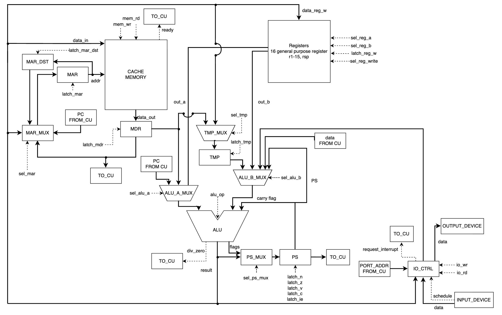
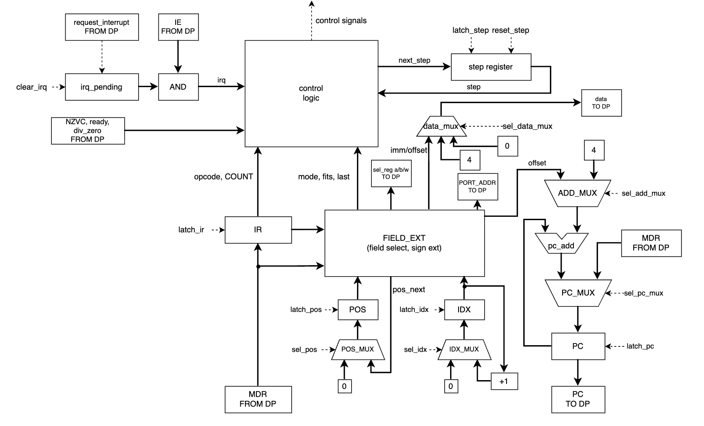
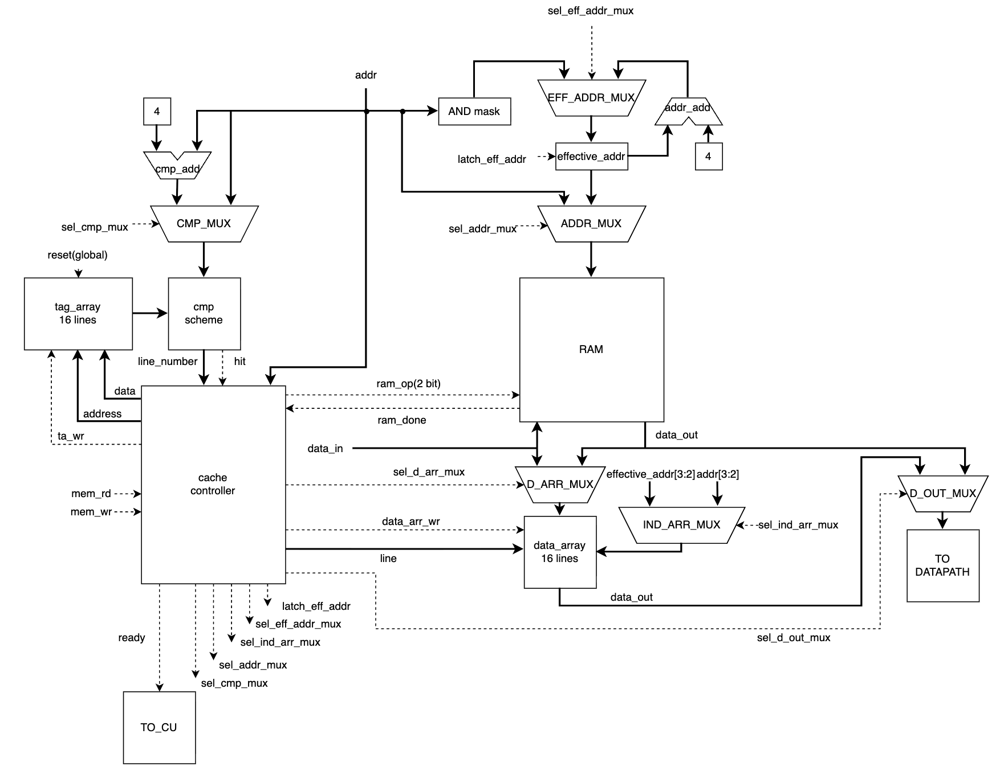

# Instruction set

## Machine model

- Word: 32 bits. Memory: byte-addressed, single-port, shared by code and data (von Neumann).
- Registers: `rsp` (reg #0), `r1`–`r15`, 32 bits each, addressed by a 4-bit field.
- Special registers: PC, PS (IE + N, Z, V, C). Not addressable.
- Instructions are whole words; PC advances by 4 per fetched word.
- RAM reads/writes any 4 consecutive bytes in one access. All data accesses are 32-bit words.
- Code and data should be aligned to 4: unaligned accesses work, but bypass the cache (see [Cache](#cache)).

## Operand modes

| # | Mode               | Syntax                  | Operand size (bits) | Notes                                                        |
|---|--------------------|-------------------------|---------------------|--------------------------------------------------------------|
| 0 | register           | `r1`                    | 4 (reg#)            | operand is the register itself                               |
| 1 | direct memory      | `(0x120)`, `(label)`    | 32 (address)        | access at the absolute address                               |
| 2 | PC-relative memory | `(@label)`              | 16 (offset)         | access at `PC_next + offset`                                 |
| 3 | register indirect  | `(r1)`                  | 4 (reg#)            | access at `r1`                                               |
| 4 | postincrement      | `(r1)+`                 | 4 (reg#)            | access at `r1`, then `r1 ← r1 + 4`                           |
| 5 | predecrement       | `-(r1)`                 | 4 (reg#)            | `r1 ← r1 − 4`, then access at `r1`                           |
| 6 | immediate          | `120`, `0x120`, `label` | 16 (value)          | value stored in the instruction; a bare label is its address |
| 7 | register relative  | `(r1+10)`               | 20 (reg# + offset)  | access at `r1 + offset`                                      |

- `PC_next` — address of the next instruction. Offsets are computed by the translator: `addr(label) − PC_next`.
- Syntax rule: bare — value, parentheses — memory.
- Assembler errors:
  - immediate as destination;
  - `cmp` / `test`: first operand is an immediate;
  - both operands use `+` / `-`;
  - a register used with `+` / `-` appears in another operand of the same instruction.
- `jump` / `call` do not use operand modes, see [Jump targets](#jump-targets).

## Commands

`Format` — see [Instruction formats](#instruction-formats).

`Flags` — flags set from the result; flags not listed are unchanged. `X ← 0` — flag is cleared.
- N — result bit 31; Z — result is 0; V — signed overflow; C — unsigned carry out (borrow for `sub`/`subc`/`cmp`/`neg`).
- Shifts: C — last bit shifted out.

### Data movement
| Instruction  | Meaning    | Format | Flags |
|--------------|------------|--------|-------|
| mov dst, src | dst ← src  | F2     | NZ    |

### Logical
| Instruction  | Meaning          | Format | Flags       |
|--------------|------------------|--------|-------------|
| clr dst      | dst ← 0          | F1     | NZ; V,C ← 0 |
| not dst      | dst ← ~dst       | F1     | NZ; V,C ← 0 |
| and dst, src | dst ← dst & src  | F2     | NZ; V,C ← 0 |
| or dst, src  | dst ← dst \| src | F2     | NZ; V,C ← 0 |
| xor dst, src | dst ← dst ^ src  | F2     | NZ; V,C ← 0 |

### Arithmetic
| Instruction               | Meaning                                 | Format | Flags             |
|---------------------------|-----------------------------------------|--------|-------------------|
| inc dst                   | dst ← dst + 1                           | F1     | NZV               |
| dec dst                   | dst ← dst − 1                           | F1     | NZV               |
| neg dst                   | dst ← −dst                              | F1     | NZVC              |
| add dst, src              | dst ← dst + src                         | F2     | NZVC              |
| addc dst, src             | dst ← dst + src + C                     | F2     | NZVC              |
| sub dst, src              | dst ← dst − src                         | F2     | NZVC              |
| subc dst, src             | dst ← dst − src − C                     | F2     | NZVC              |
| mulh dst, src             | dst ← (dst × src) bits 63:32 (signed)   | F2     | NZ                |
| umulh dst, src            | dst ← (dst × src) bits 63:32 (unsigned) | F2     | NZ                |
| mull dst, src             | dst ← (dst × src) bits 31:0             | F2     | NZ                |
| div dst, src              | dst ← dst / src (signed, truncated)     | F2     | NZ                |
| mod dst, src              | dst ← dst % src (signed). -7 % 2 = -1   | F2     | NZ                |
| cmp a, b                  | flags ← a − b                           | F2     | NZVC              |
| test a, b                 | flags ← a & b                           | F2     | NZ; V,C ← 0       |
| addm dst, src1, ..., srcN | dst ← dst + src1 + ... + srcN           | FA     | NZ (final result) |

### Shifts
| Instruction    | Meaning                          | Format | Flags |
|----------------|----------------------------------|--------|-------|
| lsl dst, count | dst ← dst << count (zero-filled) | F2     | NZC   |
| asl dst, count | alias of `lsl`                   | F2     | NZC   |
| lsr dst, count | dst ← dst >> count (zero-filled) | F2     | NZC   |
| asr dst, count | dst ← dst >> count (sign-filled) | F2     | NZC   |

`count mod 32` is used.

### Stack
| Instruction       | Meaning                              | Format | Flags |
|-------------------|--------------------------------------|--------|-------|
| push operand      | alias of `mov -(rsp), operand`       | F2     | NZ    |
| pop operand       | alias of `mov operand, (rsp)+`       | F2     | NZ    |
| pushm r2, r1, r13 | push registers in list order         | FP     | —     |
| popm r13, r1, r2  | pop into registers in list order     | FP     | —     |
| call target       | push PC_next, PC ← target            | FJ     | —     |
| ret               | pop PC                               | F0     | —     |
| iret              | pop PS, pop PC                       | F0     | —     |

Stack grows down. `pushm` / `popm` both go in list order, so restoring needs the reversed list:
```asm
pushm r1, r2   ; push r1, then r2
popm  r2, r1   ; pop into r2, then r1
```

### IO
| Instruction   | Meaning        | Format | Flags       |
|---------------|----------------|--------|-------------|
| in dst, port  | dst ← IO[port] | F2     | NZ; V,C ← 0 |
| out port, src | IO[port] ← src | F2     | —           |

- `port` — immediate only. Ports are a separate address space.
- 0 — input: last character from the input schedule; its arrival raises the interrupt.
- 1 — output: writing appends a character to the output buffer.

### Control flow
| Instruction  | Meaning / condition   | Format | Flags |
|--------------|-----------------------|--------|-------|
| jump target  | PC ← target           | FJ     | —     |
| jz  label    | Z == 1                | FB     | —     |
| jnz label    | Z == 0                | FB     | —     |
| ja  label    | C == 0 && Z == 0      | FB     | —     |
| jae label    | C == 0                | FB     | —     |
| jb  label    | C == 1                | FB     | —     |
| jbe label    | C == 1 \|\| Z == 1    | FB     | —     |
| jl  label    | N != V                | FB     | —     |
| jle label    | Z == 1 \|\| N != V    | FB     | —     |
| jg  label    | Z == 0 && N == V      | FB     | —     |
| jge label    | N == V                | FB     | —     |
| ei           | IE ← 1                | F0     | IE    |
| di           | IE ← 0                | F0     | IE    |
| halt         | stop execution        | F0     | —     |

Conditional jumps: if the condition holds, `PC ← PC_next + offset`. Always PC-relative.

### Jump targets

| Syntax   | Kind        | `jump`                | `call`                           | Size         |
|----------|-------------|-----------------------|----------------------------------|--------------|
| `label`  | absolute    | PC ← label            | push PC_next, PC ← label         | 2 words      |
| `@label` | PC-relative | PC ← PC_next + offset | push PC_next, PC ← PC_next + offset | 1 word    |

## Interrupts

One interrupt source: input (port 0).

### Vectors
| Address | Contents                                    |
|---------|---------------------------------------------|
| 0x0     | reset vector — `addr(_start)`               |
| 0x4     | interrupt vector — `addr(_handler)` or 0    |

Filled by the linker. `0x0`–`0x7` are reserved.

### Reset
- `PC ← mem[0x0]`, `IE ← 0`, `irq_pending ← 0`. `rsp` is not initialised.

### Request
- A character from the input schedule arrives: `IO[0] ← char`, `irq_pending ← 1`.
- `irq_pending` is a single bit — requests are not queued. A new character while `irq_pending = 1`
  overwrites `IO[0]`: the previous one is lost.

### Entry
Checked after each instruction completes (never in the middle of one):
```
if irq_pending == 1 and IE == 1:
    irq_pending ← 0
    push PC
    push PS
    IE ← 0
    PC ← mem[0x4]
```

### Return
`iret`: pop PS (restores IE and NZVC), then pop PC.

### Interrupt during interrupt
- The handler runs with `IE = 0`. A request arriving meanwhile is latched in `irq_pending` and serviced right after `iret`.
- The handler may execute `ei` to allow nesting: PC and PS are on the stack, so nested entries are safe.

## Cache
- 16 lines × 16 bytes, fully associative, tree-PLRU replacement.
- Write-through, no-allocate on write miss.
- Reset clears all valid bits.

| ID | Access              | Action                                                                                       | Ticks | Tick notes                               |
|----|---------------------|----------------------------------------------------------------------------------------------|-------|------------------------------------------|
| R1 | Aligned read, hit   | Return word from `data_array` (picked by `addr[3:2]`)                                        | 1     | cache access                             |
| R2 | Aligned read, miss  | Pick victim (invalid first, then tree-PLRU), burst-fill line, write tag + valid, return word | 14    | 10 first word + 3×1 burst + 1 cache read |
| R3 | Unaligned read      | Bypass: single RAM read, cache untouched                                                     | 10    | one RAM access                           |
| W1 | Aligned write, hit  | Write word to `data_array` and RAM                                                           | 10    | RAM write; cache write in parallel       |
| W2 | Aligned write, miss | Write to RAM only                                                                            | 10    | one RAM access                           |
| W3 | Unaligned write     | Write to RAM, invalidate every cached line it touches (1 or 2)                               | 10–12 | RAM write + 1 tick per invalidated line  |

## Instruction formats

- Padding and unused bits are 0.
- Operands are placed **from bit 0 upward**: each one takes the lowest free bits of its area.
- Signed fields (immediate, offsets) are sign-extended to 32 bits by the CU.
- Register-relative field: `reg#` in its bits [19:16], `offset` in [15:0].

### F0 — 0 operands
```
[31:26 OPCODE][25:0 padding]
```
Size: 1 word.

### F1 — 1 operand
```
word1: [31:26 OPCODE][25:23 MODE][22:0 operand]
ext:   [31:0 address]                      ; absolute mode only
```
Every mode except absolute fits inline. Size: 1–2 words.

### F2 — 2 operands
```
word1: [31:26 OPCODE][25:23 MODE1][22:20 MODE2][19:0 inline operands]
ext:   [31:0 operand, right-aligned]       ; 0–2 words
```
Placement is greedy:
1. Try operand 1 inline, then operand 2 in the remaining bits.
2. Operands that did not fit go to extension words, in operand order.
3. Absolute address never fits inline.

So operand 2 may be inline while operand 1 is in an extension word:
```
word1: [OPCODE | MODE1 | MODE2 | OPERAND2]
word2: [OPERAND1]
```

| Operand sizes (bits)              | Words |
|-----------------------------------|-------|
| 4 + 4, 4 + 16                     | 1     |
| 4 + 20, 16 + 16, 16 + 20, 20 + 20 | 2     |
| absolute + non-absolute           | 2     |
| absolute + absolute               | 3     |

### FB — conditional branch
```
[31:26 OPCODE][25:16 padding][15:0 offset]
```
Size: 1 word.

### FJ — `jump` / `call`
```
word1: [31:26 OPCODE][25 K][24:16 padding][15:0 offset]
ext:   [31:0 address]                      ; K = 0 only
```
K = 1 — PC-relative (1 word); K = 0 — absolute, offset field is 0 (2 words).

### FP — `pushm` / `popm`
```
word1: [31:26 OPCODE][25:22 COUNT][21:20 padding][19:0 reg0..reg4, reg0 at [3:0]]
ext:   [31:0 next 8 registers]
```
COUNT = number of registers − 1 (1–16 registers).

| Registers | Words |
|-----------|-------|
| 1–5       | 1     |
| 6–13      | 2     |
| 14–16     | 3     |

### FA — `addm`
```
word1:  [31:26 OPCODE][25:23 COUNT][22:21 padding][20:0 MODE1..MODE7, MODE1 at [2:0]]
value:  [31:0 operand values]              ; 1+ words
```
- COUNT = number of operands − 1, incl. the destination (operand 1). 1–7 operands.
- Unused mode slots are 0.
- Values are packed in operand order, next-fit: a value goes into the rest of the current word if it
  fits, otherwise it starts the next word. A value never crosses a word boundary.
- Word 1 holds only modes, so every `addm` spans at least 2 words.

```
addm r1, r2, r3, r4                 ; 2 words
word1: [OPCODE | COUNT=3 | modes: reg, reg, reg, reg]
word2: [r4 | r3 | r2 | r1]

addm r1, (0x2000), (0x3000)         ; 4 words
word1: [OPCODE | COUNT=2 | modes: reg, abs, abs]
word2: [r1]
word3: [0x2000]
word4: [0x3000]

addm r1, (r2+8), 100                ; 3 words
word1: [OPCODE | COUNT=2 | modes: reg, reg-rel, imm]
word2: [r2, 8 | r1]
word3: [100]
```

## Opcodes

| Opcode | Binary | Instruction           | Format |
|--------|--------|-----------------------|--------|
| 0x00   | 000000 | — (reserved, invalid) | —      |
| 0x01   | 000001 | halt                  | F0     |
| 0x02   | 000010 | ret                   | F0     |
| 0x03   | 000011 | iret                  | F0     |
| 0x04   | 000100 | ei                    | F0     |
| 0x05   | 000101 | di                    | F0     |
| 0x08   | 001000 | clr                   | F1     |
| 0x09   | 001001 | not                   | F1     |
| 0x0A   | 001010 | inc                   | F1     |
| 0x0B   | 001011 | dec                   | F1     |
| 0x0C   | 001100 | neg                   | F1     |
| 0x0E   | 001110 | jump                  | FJ     |
| 0x0F   | 001111 | call                  | FJ     |
| 0x10   | 010000 | pushm                 | FP     |
| 0x11   | 010001 | popm                  | FP     |
| 0x12   | 010010 | addm                  | FA     |
| 0x18   | 011000 | jz                    | FB     |
| 0x19   | 011001 | jnz                   | FB     |
| 0x1A   | 011010 | ja                    | FB     |
| 0x1B   | 011011 | jae                   | FB     |
| 0x1C   | 011100 | jb                    | FB     |
| 0x1D   | 011101 | jbe                   | FB     |
| 0x1E   | 011110 | jl                    | FB     |
| 0x1F   | 011111 | jle                   | FB     |
| 0x20   | 100000 | jg                    | FB     |
| 0x21   | 100001 | jge                   | FB     |
| 0x28   | 101000 | mov                   | F2     |
| 0x29   | 101001 | and                   | F2     |
| 0x2A   | 101010 | or                    | F2     |
| 0x2B   | 101011 | xor                   | F2     |
| 0x2C   | 101100 | add                   | F2     |
| 0x2D   | 101101 | addc                  | F2     |
| 0x2E   | 101110 | sub                   | F2     |
| 0x2F   | 101111 | subc                  | F2     |
| 0x30   | 110000 | mulh                  | F2     |
| 0x31   | 110001 | umulh                 | F2     |
| 0x32   | 110010 | mull                  | F2     |
| 0x33   | 110011 | div                   | F2     |
| 0x34   | 110100 | mod                   | F2     |
| 0x35   | 110101 | cmp                   | F2     |
| 0x36   | 110110 | test                  | F2     |
| 0x37   | 110111 | lsl                   | F2     |
| 0x38   | 111000 | lsr                   | F2     |
| 0x39   | 111001 | asr                   | F2     |
| 0x3A   | 111010 | in                    | F2     |
| 0x3B   | 111011 | out                   | F2     |

- Grouped by format with gaps; the opcode alone determines the format.
- Aliases (`asl`, `push`, `pop`) have no opcode.

## Field sizes

| Field                                                      | Size                        |
|------------------------------------------------------------|-----------------------------|
| OPCODE                                                     | 6 bits                      |
| MODE                                                       | 3 bits                      |
| register (register, indirect, postincrement, predecrement) | 4 bits                      |
| immediate                                                  | 16 bits, signed             |
| PC-relative / branch / jump offset                         | 16 bits, signed, in bytes   |
| register-relative                                          | 4 + 16 bits (reg# + offset) |
| absolute address                                           | 32 bits                     |
| K (`jump`/`call` kind)                                     | 1 bit                       |
| COUNT (`pushm`/`popm`)                                     | 4 bits                      |
| COUNT (`addm`)                                             | 3 bits                      |

## Immediates

- There are no 32-bit immediates. Larger constants are stored in `data` and loaded, or built with shift / or.
- `mov r1, label` loads the address of `label`; the address must be `< 0x8000`, otherwise translator error.
## Programming language

### Syntax (EBNF)

```
(* --- structure --- *)
<program>   ::= { <line> | <macro> | <define> | <condition> | <directive> }
<end>       ::= [ <comment> ] <eol>
<eol>       ::= "\n" | <EOF>

(* --- preprocessor --- *)
<macro>     ::= "#macro" <name> "," <non_neg_number> { "\n" }
                "{" <end>
                { <raw_line> }
                "}" <end>
<raw_line>  ::= ? any characters except newline, or unopened "{" ? <eol>

<define>    ::= "#define" <name> [ <value> ] <eol>

<condition> ::= ( "#ifdef" | "#ifndef" ) <name> <end>
                <program>
                [ "#else" <end> <program> ]
                "#endif" <end>

(* --- directives --- *)
<directive> ::= ( ".section" ( "data" | "text" )
                | ".org" <non_neg_number>
                | ".import" <name>
                | ".export" <name>
                ) <end>

(* --- lines --- *)
<line>        ::= [ <label> ] [ <data> | <instruction> ] <end>
<label>       ::= <name> ":"

<data>        ::= ".word" <word> { "," <word> }
                | ".pstr" <string>
                | ".ref" <name>
<word>        ::= <number> | <char>

<instruction> ::= <command> [ <operand> { "," <operand> } ]
<command>     ::= ? any mnemonic from the instruction list, or a macro name ?

<operand>     ::= <register>                                        (* register *)
                | "(" ( <non_neg_number> | <name> ) ")"             (* direct *)
                | "(" "@" <name> ")"                                (* PC-relative *)
                | "(" <register> ")"                                (* indirect *)
                | "(" <register> ")" "+"                            (* postincrement *)
                | "-" "(" <register> ")"                            (* predecrement *)
                | "(" <register> ( "+" | "-" ) <non_neg_number> ")" (* register-relative *)
                | <number> | <name> | <char>                        (* immediate *)
                | "@" <name>                                        (* jump PC-relative *)
<register>    ::= "rsp" | "r1" | "r2" | ... | "r15"

(* --- tokens --- *)
<name>           ::= ( <letter> | "_" ) { <letter> | <digit> | "_" }
<number>         ::= [ "-" ] <non_neg_number>
<non_neg_number> ::= <digit> { <digit> } | "0x" <hex_digit> { <hex_digit> }
<char>           ::= '"' <str_char> '"'
<string>         ::= '"' { <str_char> } '"'
<str_char>       ::= ? printable ASCII character 0x20–0x7E, except "\" and '"' ?
                   | "\" ( "n" | "t" | "\" | '"' | "0" )
<comment>        ::= ";" { ? any UTF-8 character except newline ? }
<value>          ::= ? any characters up to the end of the line ?

<letter>, <digit>, <hex_digit> have their usual meaning: a–z A–Z; 0–9; 0–9 a–f A–F.
<EOF> is the end of input.
```

Notes:
- The language is case-sensitive.
- Spaces and tabs between tokens are ignored; newlines are not. Spaces inside strings, comments and
  define values are kept. Names must be separated by spaces.
- Number values must be in the range $[-2^{31},\ 2^{32}-1]$; otherwise it is a translator error.
- Reserved words cannot be used as labels or macro names: register names, mnemonics, 
keywords, and names of already defined macros.
- A `#define` line cannot have a comment: everything including ";" will be added as value
- A macro body is not parsed at definition time. It is stored as raw lines and parsed only after
  expansion, after `%N` replacement.
- A macro call has the same syntax as an instruction; the
  preprocessor expands it before assembly.
- A macro definition cannot appear inside another macro definition, including through a
  conditional block; it is a preprocessor error.

### Semantics

**Instructions.** Executed sequentially, starting from `_start`. Meaning, operand modes, flags and
cycle counts are described in the ISA section.

**Labels.**
- A label marks the address of the next emitted word (instruction or data). The label may stand on
  its own line or before an instruction or data on the same line.
- A label may be used before its definition.
- A label is local to its file unless it is exported with `.export`.
- Another file can use an exported label only after declaring it with `.import`. Using a name that
  is neither defined in the file nor imported is an error.
- Duplicate labels within a file are an error.
- A label exported by more than one file in the same link is an error.

**Data.**
- `.word v1, v2, ...` — one word per value. A char literal `"c"` is its ASCII code;
  negative numbers are stored in two's complement.
- `.pstr "text"` — emits a word with the length, then one word per character. Escapes
  `\n \t \\ \" \0` denote a single character.
- `.ref name` — emits one word containing the address of `name`, filled in by the linker.

**Sections.**
- `.section data|text` switches the current section; switching back to a section continues it.
- The default section is `text`.
- Instructions in `data` and data in `text` are not allowed, causing translation error.
- `.org N` — sets offset within file, section.

**Preprocessor.** One top-down pass over the text, before assembly. Expanded macro bodies are
processed like ordinary code.
- `#define NAME value` — replaces the whole identifier `NAME` with `value` (the rest of the line)
from the next line on. Strings and comments are skipped.  Redefinition is allowed.
- `#ifdef` / `#ifndef NAME` … [`#else`] … `#endif` — keeps one branch; blocks may nest.
- `#macro name, N { ... }` — a call `name a0, ..., aN-1` is replaced by the body, with `%i` → `ai`.
Arguments are split on commas outside quotes.
- Defines and macros are local to the file.

**Entry points.**
- The linker writes the address of `_start` into the reset vector and the address of `_handler`
  into the interrupt vector (see Memory organization).
- Both must be exported with `.export`; the linker takes them from the export tables, and no file
  imports them.
- No exported `_start` is an error.
- No exported `_handler` leaves the interrupt vector at 0.

**Types.** There are no types: every value is a 32-bit word. Signed or unsigned interpretation is chosen by 
operation (`jl` vs `jb`).


## Translator

### CLI tool

```
ailurus-build [flags] FILE...
```

`FILE` is a source file (`.asm`) or an object file (`.o`). By default all inputs are assembled and
linked together with the standard library into one flat binary image.

| Flag              | Meaning                                                        |
|-------------------|----------------------------------------------------------------|
| `-o FILE`         | output file (default `a.bin`)                                  |
| `-l FILE`         | debug listing: `<address> - <HEXCODE> - <mnemonic>`            |
| `-c`              | assemble only: one `.o` per input, no linking                  |
| `-E`              | preprocess only: print expanded source to stdout               |
| `-D NAME[=value]` | define `NAME`, as if `#define` were at the top of every file   |
| `--no-stdlib`     | do not link the standard library                               |

### Pipeline

Translation pipeline includes 3 stages:
1. Preprocessor - receives source code, returns source code after expanding macros, defines, conditional blocks
2. Assembler - receives code after preprocessor, converts instructions into machine code, creates symbol and relocation
   tables, converts data definitions(.pstr, .ref, .word) and returns an object file
3. Linker - receives several object files, resolves symbol references, does relocations, places sections and fills the vectors
   from `_start` and `_handler` and returns a single flat image binary.

### Preprocessor

- Single top to bottom pass.
- Keep table with defines and macros.
- The expanded macros are fed back into the stream
- Each line is split into tokens. The tokens found in tables are substituted
- A macro call replaces the whole line with the macro body, `%i` replaced by the i-th argument.
  The expanded lines are fed back into the stream, so defines and conditionals apply to them.
- Line tracking: every output line keeps its origin `file:line`. Expanded lines keep the line of
  the macro call, so errors and the listing point to real source.

### Assembling

Each line becomes a statement, aliases are rewritten.

Single pass compilation + fixup:

An instruction is encoded right away. Its size comes from the format and operand modes, using the greedy packing.
If operand can not be determined right away(for example, address of label which has not been defined yet),
operand is written as 0 and recorded as fixup.

At the end of the file: fixup resolution - PC relative to a local label in the same section is fixed

One pass is enough, because an instruction’s size depends only on its mnemonic and modes, not on the label values.

### Linking
- First text part starts at 0x8, after start and interrupt vectors.
- All text parts go in first, then - data. Both in the file order.
- Each part starts at a 4-byte-aligned address, gaps are filled with 0.

**Symbol resolution**

- `.org` directive defines offset within the file and section. Later, when source code is linked address will be = base(file, section) + offset.
- For symbol resolution a global table is built from every file’s exports, mapping name to final address.
- A name exported twice is an error.
- Imports are looked in this table. Error if missing one.
- _start must be exported; _handler is optional.
- stdlib is placed last

- **Relocation**

For each entry, compute the value, run the check, and write the field.

| Kind      | Value                | Check                      |
|-----------|----------------------|----------------------------|
| `abs32`   | $S$                  | none                       |
| `imm16`   | $S$                  | $S \le \texttt{0x7FFF}$    |
| `pcrel16` | $S - \text{PC_next}$ | $\in [-2^{15},\ 2^{15}-1]$ |

A failed check is an error.

- Vectors: mem[0x0] ← addr(_start), and mem[0x4] ← addr(_handler) or 0 if there’s none.

### Object file format

This file is used between assembling and linking stages.
It is stored as JSON: it is an intermediate file, so readability matters. The final machine code is binary.

Example for:

```asm
.import print
.export _start
.section text
_start:
    mov r1, (@msg)
    call print
loop:
    jz loop
.section data
msg: .pstr "hi"
```

```json
{
  "version": 1,
  "source": "main.asm",
  "sections": {
    "text": "<bytes, hex>",
    "data": "<bytes, hex>"
  },
  "symbols": [
    { "name": "print",  "binding": "import" },
    { "name": "_start", "binding": "export", "section": "text", "offset": 0 },
    { "name": "loop",   "binding": "local",  "section": "text", "offset": 16 },
    { "name": "msg",    "binding": "local",  "section": "data", "offset": 0 }
  ],
  "relocations": [
    { "section": "text", "offset": 0, "bit": 0, "width": 16,
      "kind": "pcrel16", "symbol": "msg", "pc_next": 4 },
    { "section": "text", "offset": 8, "bit": 0, "width": 32,
      "kind": "abs32", "symbol": "print" }
  ],
  "lines": [
    { "section": "text", "offset": 0,  "line": 5,  "text": "mov r1, (@msg)" },
    { "section": "text", "offset": 4,  "line": 6,  "text": "call print" },
    { "section": "text", "offset": 16, "line": 8,  "text": "jz loop" },
    { "section": "data", "offset": 0,  "line": 10, "text": "msg: .pstr \"hi\"" }
  ]
}
```

Fields:

- `version`, `source` — version and source file name.
- `sections` — bytes of `text` and `data`.
- `symbols` — every label of the file:
  - `local` — visible only in this file.
  - `export` — added to the linker's global table.
  - `import` — must be found among the exports of other files; has no section or offset.
- `relocations` — fields the assembler could not fill:
  - `section`, `offset` — the word containing the field;
    `bit`, `width` — the field's position inside the word.
  - `kind` — `abs32`, `imm16` or `pcrel16`.
  - `symbol` — looked up among this file's symbols first, then among global exports.
  - `pc_next` — `pcrel16` only: offset of the next instruction in the same section.
- `lines` — one entry per emitted instruction or data item. Used for debug listing


## Memory organization

### Memory model

- Von Neumann: code and data share one memory. Single-port, byte-addressed.
- Word: 32 bits. Little-endian: the lowest byte of a word is at the lowest address.
- Memory size is set in the simulator config.
- Registers available to the programmer: `rsp`, `r1`–`r15`.
- PC and PS are not addressable; they change only through control flow, PC-relative modes, flags and `ei` / `di`.
- IO ports are a separate address space (port 0 — input, port 1 — output).

### Layout
```
        Memory
+-------------------------------+
| 0x0  : reset vector → _start  |
| 0x4  : irq vector → _handler  |
| 0x8  : text, file 1           |
|        text, file 2           |
|        ...                    |
|        text, stdlib           |
|        data, file 1           |
|        ...                    |
|        data, stdlib           |
|        free                   |
|        ...                    |
| top  : stack (grows down)     |
+-------------------------------+
```

- Each file's section part starts at a 4-byte-aligned address.
- `rsp` is not initialized at reset: `_start` must set it.

### Mapping

| Entity      | Where                                                                                                              |
|-------------|--------------------------------------------------------------------------------------------------------------------|
| Literal     | fits in $[-2^{15},\ 2^{15}-1]$ → immediate inside the instruction; otherwise the programmer must load it from data |
| Constant    | `#define` — text substitution, no memory.                                                                          |
| Variable    | `.word` in `data` (static). Registers and stack are used manually — no register allocation.                        |
| Multi-word  | consecutive words, low word first (64-bit: `addr` — bits $[31:0]$, `addr+4` — bits $[63:32]$).                     |
| String      | `.pstr` in `data`: length word, then one word per character.                                                       |
| Instruction | `text`, 1–4 words.                                                                                                 |
| Procedure   | code in `text`, `call` / `ret` through the stack.                                                                  |
| Interrupt   | handler is code in `text`, its address is in the `0x4` vector. Entry pushes PC and PS.                             |

- Compile time: the assembler places everything at offsets within sections; the linker assigns final addresses and fills the vectors.
- Run time: only registers, the stack and `data` contents change.

### Calling convention

| What         | Rule                                          |
|--------------|-----------------------------------------------|
| Arguments    | `r1`–`r4`; on the stack, pushed right to left |
| Return value | `r1`; 64-bit — `r1` low, `r2` high            |
| Caller-saved | `r1`–`r7`: a procedure may change them        |
| Callee-saved | `r8`–`r15`, `rsp`: restored before `ret`      |

- The interrupt handler preserves every register it uses: hardware saves only PC and PS.

## Processor model

### Simulator CLI

```
ailurus-run prog.bin [-l prog.lst] [-c config.yaml]
```

| Flag      | Meaning                                                             |
|-----------|---------------------------------------------------------------------|
| `-l FILE` | file from `ailurus-build`: maps addresses to source for the journal |
| `-c FILE` | simulator config                                                    |

Output: the output buffer and the journal.

Config:
```yaml
memory_size: 4096   # bytes
cache: true         # false: direct RAM
tick_limit: 100000  
input:              # interrupt schedule: [tick, char]
  - [10, "h"]
  - [25, "i"]
```

### Datapath



- `result` (ALU output) is the only write bus.
- Register file: 2 read ports, 1 write port.
- MAR_DST — destination address, in order to save during operand fetch. 
- TMP - destination value / sum for `addm`.
- PS — IE + NZVC, each bit latched separately; carry goes back to the ALU for `addc` / `subc`.
  PS_MUX takes ALU flags or `result` (`iret`).
- IO_CTRL — port address from CU; . On a scheduled tick the input device writes
  port 0 and raises `request_interrupt`.
- To CU: `ready`, `div_zero`, PS, MDR, `request_interrupt`.

TODO: ALU operations

### ControlUnit



Hardwired. `control logic` is combinational.

- IR keeps word 1 for the whole instruction; extension words stay in MDR.
- step — tick inside the current phase.
- `irq = irq_pending AND IE`.
- PC: `pc_add = PC + (offset | 4)`; PC_MUX takes `pc_add` or MDR (`ret`, `iret`, absolute targets, vectors).
- data_mux → DataPath: imm/offset, `4` (stack / postincrement step), `0`.

Phases: interrupt check → IF → OF (per operand) → execute → writeback.

**FIELD_EXT** extracts the current operand from IR (IDX = 0) or MDR (IDX ≥ 1) at bit POS.
Outputs: field value (sign-extended if signed), register numbers, port address, mode,
`fits`, `last`, `pos_next = POS + width`.

| Field             | Width | Signed       | Used by                            |
|-------------------|-------|--------------|------------------------------------|
| register          | 4     | —            | modes 0, 3, 4, 5; FP               |
| immediate         | 16    | yes          | mode 6; port                       |
| PC-relative       | 16    | yes          | mode 2; FB, FJ                     |
| register-relative | 20    | offset — yes | mode 7: reg [19:16], offset [15:0] |
| absolute          | 32    | —            | mode 1; FJ with K = 0              |

| Format | Modes in IR                       | Operand area, IDX = 0 | IDX ≥ 1 |
|--------|-----------------------------------|-----------------------|---------|
| F1     | [25:23]                           | [22:0]                | 32 bits |
| F2     | [25:23], [22:20]                  | [19:0]                | 32 bits |
| FB, FJ | —                                 | [15:0], K at [25]     | 32 bits |
| FP     | — (COUNT [25:22])                 | [19:0]                | 32 bits |
| FA     | [20:0], 3 bits each (COUNT [25:23]) | none                | 32 bits |

`fits = POS + width ≤ area size`. Otherwise, the next word is fetched into MDR, IDX ← IDX + 1,
POS ← 0. `last` — the current operand is the last one.

### Cache



- `cmp scheme` compares the CMP_MUX address with all 16 tags.
- `effective_addr` — burst address, then `+ 4` per word.
- IND_ARR_MUX — word in the line: `addr[3:2]` or `effective_addr[3:2]`.
- D_OUT_MUX — to DataPath: data_array or RAM (cache bypass).
- `ram_op`: 0 — none, 1 — read, 2 — write; `ram_done` — RAM finished.
- `ta_wr` — write tag + valid; `ready` — request complete, to CU.
- Alignment check, victim choice and the 15 tree-PLRU bits are inside the controller.

Controller FSM:

| State      | Action                                                                                             | Next                                                             |
|------------|----------------------------------------------------------------------------------------------------|------------------------------------------------------------------|
| `IDLE`     | wait for `mem_rd` / `mem_wr`. Aligned read hit: data_array value to DataPath, update PLRU, `ready` | read miss → `FILL`; unaligned read → `BYPASS_R`; write → `WRITE` |
| `FILL`     | `ram_op = read` at `effective_addr`; on `ram_done` store the word, `effective_addr += 4`;          | `TAG`                                                            |
| `TAG`      | `ta_wr` for the victim, update PLRU, word to DataPath, `ready`                                     | `IDLE`                                                           |
| `BYPASS_R` | `ram_op = read` at `addr`; on `ram_done` RAM value to DataPath, `ready`                            | `IDLE`                                                           |
| `WRITE`    | `ram_op = write` at `addr`; aligned hit — also write data_array; on `ram_done`: aligned → `ready`  | aligned → `IDLE`; unaligned → `INV1`                             |
| `INV1`     | compare `addr`; hit → clear valid                                                                  | `INV2`                                                           |
| `INV2`     | compare `addr + 4`; hit → clear valid; `ready`. For unaligned writes spanning 2 lines              | `IDLE`                                                           |
